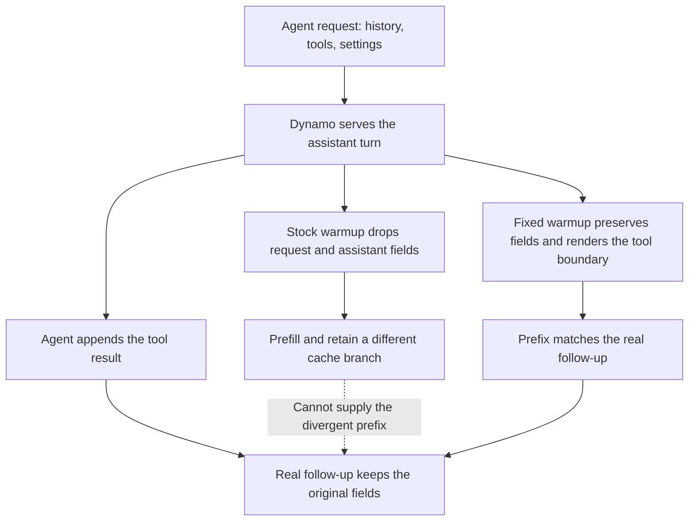

# ReedCode

ReedCode is a coding-agent harness and a set of experiments on agent inference. I built it as a research project for fun, starting with how much tool output an agent needs and following that into token use, prefix caching, and NVIDIA Dynamo.

The strongest finding so far is a bug in Dynamo's `speculative_prefill` agent hint that makes tool-calling agents pay for prefill their next request cannot reuse. On Qwen3-8B on an A100, stock warmups added **62–85% more prefill per session**, with zero extra cache hits on real follow-ups and a warmup-only KV branch of up to **2.4 GiB**. My fix removes that branch.

The project now includes a second GPU-verified request-control bug, concurrent coding sessions, and native cache-routing prototypes. The harness, experiments and fixes are below. [Speculative-prefill patch](experiments/dynamo-upstream/001-speculative-prefill/fix/README.md) · [GPU evidence](experiments/dynamo-upstream/combined-gpu-20260929/README.md)

**Upstream:** the thinking-control fix merged into Dynamo in [PR #16608](https://github.com/ai-dynamo/dynamo/pull/16608) on October 16. The speculative-prefill field fix is proposed in [contribution request #16601](https://github.com/ai-dynamo/dynamo/issues/16601); its PR awaits maintainer agreement on scope.

## Dynamo: wasted speculative prefill

Eighteen controlled GPU trials: two saved sessions, hints off/stock/fixed, three repetitions with rotated order. These whole-session prefill counts repeated exactly in each condition.

| Session | Hint off | Stock hint | Fixed hint | Stock-only KV payload at end |
| --- | ---: | ---: | ---: | ---: |
| Short | 5,205 | 8,446 | 5,240 | 450 MiB |
| Long | 20,580 | 38,114 | 20,595 | 2.4 GiB |

The fix cut prefill **38–46% versus stock**, bringing it close to hint-off cost. Fixed still computes 35 and 15 extra tokens; the useful gain on these tool turns is small. The main improvement is removing the wasted branch, which reached about 98–99% of the real context's full-block KV payload before the final tool output.

[Per-request counts, timings and block accounting](experiments/dynamo-upstream/combined-gpu-20260929/PREFILL.md). The complete GPU study cost about $2.37, including disk and the earlier failed rental.

## Why it happens

The warmup builder copies only the message history. It drops the tool definitions and template settings, then reconstructs the new assistant response from text alone. Its prompt diverges from the real continuation before most of the agent's context.

Both field-loss paths remain in the [October 29 source](https://github.com/ai-dynamo/dynamo/blob/b9c8f75d967bd5d841f556721e4892ea40dcf388/lib/llm/src/preprocessor/speculative_prefill.rs).



The CPU check reproduced the missing-field problem in Qwen, Nemotron and GPT-OSS templates. Restoring the fields gives exact prefixes in the tested Nemotron and GPT-OSS tool cases. Qwen also needs a renderer-level tool-continuation boundary. The full fix passes **54/54 prefix cases**, leaves ordinary request tokens unchanged, and passes all **19 Dynamo warmup-module tests**. [Scope](experiments/dynamo-upstream/001-speculative-prefill/scope/README.md) · [Implementation](experiments/dynamo-upstream/001-speculative-prefill/fix/README.md)

## Dynamo: ignored thinking controls

I found that Dynamo's Anthropic endpoint dropped an explicit `thinking: disabled` setting. On Qwen3 with thinking enabled by default, the model kept reasoning. The [merged fix](https://github.com/ai-dynamo/dynamo/pull/16608) passes the caller's setting through to the template.

Across **24 paired GPU comparisons**, stock generated reasoning in every disabled request; the fix generated none. On four long Claude Code snapshots, each repeated three times, generated tokens fell **74.2%** and summed response time fell **65.3%**.

Short-question accuracy fell from **3/4 to 2/4**. Turning reasoning off changes the model's answers as well as its cost. These are controlled replays of disabled requests; the original Claude sessions enabled thinking. [Results, patch and reproduction](experiments/dynamo-thinking-20261007/README.md).

## Preparing the next user turn

I then tested whether the harness could prepare conversation history before the next user message arrived. On stock Dynamo, rolling preparation supplied **9,024 additional cached tokens across eight follow-ups** in four fresh coding sessions, without seeing the next user message. One boundary contributed 5,968 tokens, following a call-limited turn in a session that began with an empty reply.

The pilot establishes useful cache reuse. Different trajectories, unequal background activity and incomplete accounting for one canceled preparation leave latency, interference and net compute savings unresolved. [Implementation, results and CPU reproduction](experiments/next-turn-preparation-20261015/README.md).

## The harness and experiments

The agent reads files, edits code, and runs shell commands. Harbor creates its Docker workspace and checks the result with the task's verifier. ReedCode keeps the selected portion of each tool result in the conversation for the next model call. The study records include token use, cache hits, tool output, timing, and verifier rewards.

| Part | What it does |
| --- | --- |
| [Agent harness](reedcode_harbor_agent.py) | Runs the tool loop against hosted APIs, direct vLLM, or Dynamo. |
| [Retention experiments](docs/retention-studies.md) | Compare the first 20,000 characters, the first 2,000, and the first/last 1,000 of each tool result. |
| [Evaluation runner](experiments/PROTOCOL.md) | Interleaves repeated conditions and reports paired differences, call counts, failures, and output-budget stops. |
| [Serving measurements](docs/dynamo.md) | Replay captured requests and measure server prefill, decode, cache use, and the effect of agent hints. |

The first studies used hosted models on a synthetic bugfix and Terminal-Bench tasks. In the later 15-trial synthetic study, all trials passed. Both 2K policies used less input than 20K, but their mean API latency was higher. That led into the server-side work: tracing exactly what gets rendered, computed, and reused. [Study results](experiments/synthetic-20260923/README.md) · [Direct vLLM setup](docs/self-hosted.md) · [All experiments](experiments/README.md)

## What else I found

- **Concurrent coding sessions.** Six public-repository tasks produced 64 model calls and 447,919 input tokens, with **85.0% cached**. All 64 inputs matched the official template, with no unexplained cache shortfall. The failed coding outcomes led to fixes in workspace-path handling and empty-response detection. [Results](experiments/dynamo-concurrent-20261007/README.md)
- **Hybrid cache routing.** I built a native selection-service prototype that accounts for attention and recurrent state together. In one CPU case, stock chose a worker credited with 3,264 tokens that the engine could not reuse. The corrected selector chose another worker with 2,720 usable tokens. The same report covers a small stale-state fix for Dynamo's draft carrier router, plus the prototype's measured CPU overhead. [Patches and results](experiments/dynamo-routing-20261007/README.md)
- **Real harness history changes.** Qwen strips earlier-turn reasoning from Codex's rendered history. Claude Code removes reminder text on resume. Both shorten the reusable prefix. Dynamo reused every compatible full block in the two completed sessions. [Parity report](experiments/dynamo-upstream/combined-gpu-20260929/PARITY.md)
- **A stock 1.5 startup failure.** A frontend with a fixed RPC port failed to register the model. Dynamic port selection worked. The source path has since changed on main. [Failure and source comparison](experiments/dynamo-upstream/006-fixed-rpc-registration/README.md)
- **Missing request linkage.** Warmup requests lack a direct link to the request that triggered them, making their cost and eventual reuse harder to trace. [Observability findings](experiments/dynamo-upstream/005-observability/README.md)
- **A useful negative result.** Across 42 tool continuations, corrected preparation added a median of only 80 tokens. That stopped me from building a scheduling policy for a workload with little to gain. [Survey](experiments/dynamo-prefix/trajectory-survey.md)

## Running it

From the repository root, with Python 3.12+ and [uv](https://docs.astral.sh/uv/):

```bash
uv run --no-project --with msgpack==1.1.1 --with xxhash==3.5.0 --with httpx==0.28.1 python \
  experiments/dynamo-upstream/combined-gpu-20260929/reproduce.py \
  --output /tmp/reedcode-combined-reproduced
```

This checks the hashes and rebuilds both reports from the saved captures. No GPU or model API is needed. It covers all 18 prefill trials, both completed harness sessions and the failed original Claude 32K attempt.

```bash
uv sync --locked
uv run python -m unittest discover -s tests
```

[Thinking-control analysis](experiments/dynamo-thinking-20261007/README.md#reproduce) and [routing checks](experiments/dynamo-routing-20261007/README.md) have their own commands.

[Dynamo setup](docs/dynamo.md) covers live serving runs. [Harness setup and settings](docs/retention-studies.md#running-it) covers Docker, credentials, task execution, and retention experiments.

## Limitations

The retention studies cover one synthetic task and initial Terminal-Bench pilots. The speculative-prefill comparison uses one Qwen3-8B deployment and one discarded generated token per request. KV payload excludes allocator overhead; cross-model checks are CPU-only. The full runtime fix supports the pinned Qwen tool template. Codex used 32K context; Claude completed with 64K YaRN. The thinking-control snapshots come from one session, and no proposed tools were executed. The concurrent study had failed tasks and no cache pressure. The routing prototypes have CPU validation only. Fleet throughput and quality-preserving shared-server gains remain unmeasured.
